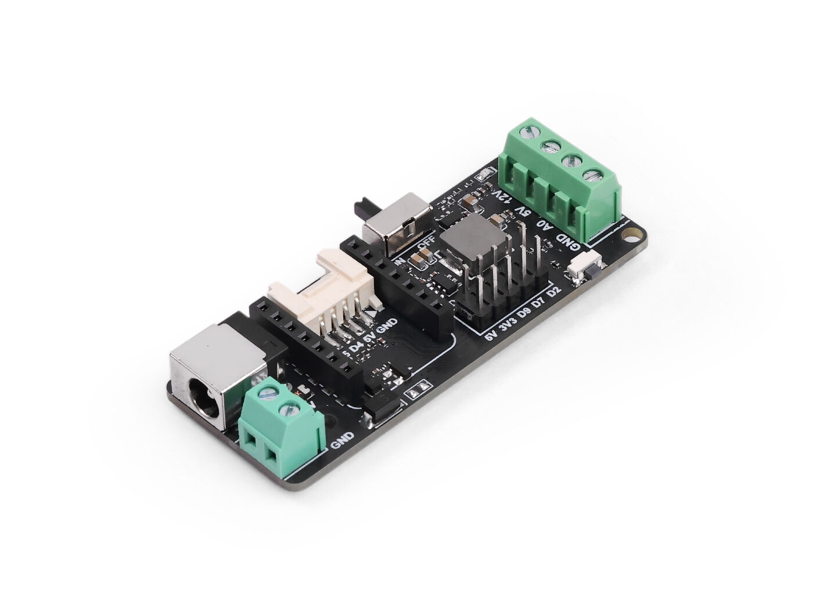
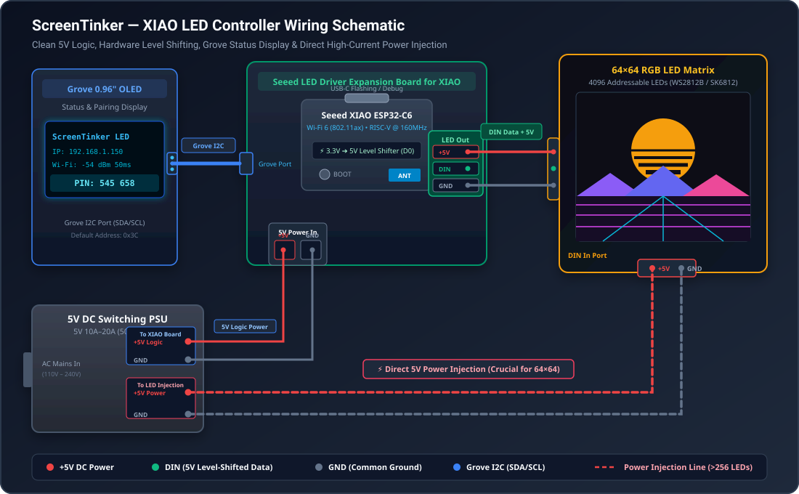
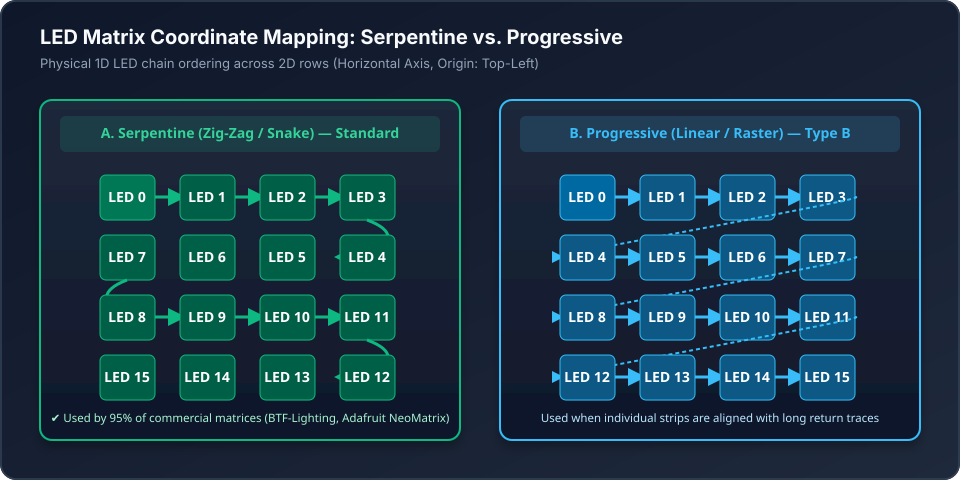
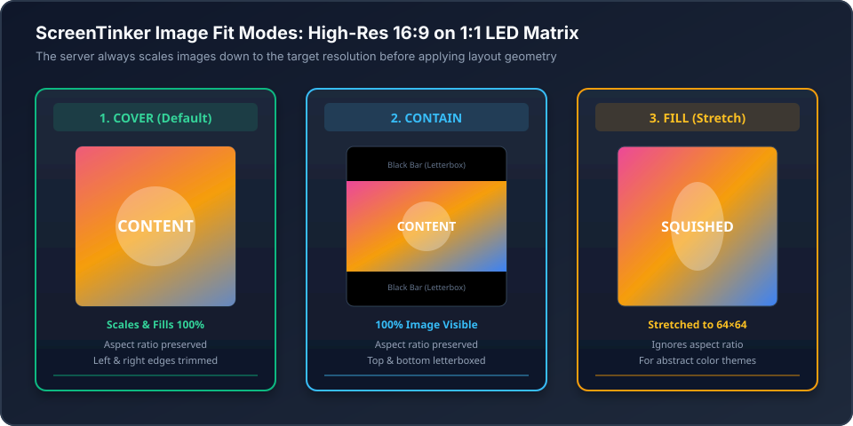

# ScreenTinker MCU — LED Mode Master Documentation

ScreenTinker LED Mode turns compact Seeed Studio XIAO microcontrollers into high-speed, server-driven smart LED controllers for addressable RGB LED strips and matrices (WS2812B, SK6812, WS2811).

Instead of running hardcoded light patterns, LED Mode connects directly to your ScreenTinker digital signage server over Wi-Fi, downloading pixel art, color gradients, ambient lighting themes, and live tickers rendered dynamically by the server in 24-bit raw RGB888.

---

## 1. Supported Microcontrollers

ScreenTinker supports the entire Seeed Studio XIAO ESP32 family:

| Board Target | MCU Architecture | Flash / RAM | PSRAM | Features | Build Environment |
| :--- | :--- | :--- | :--- | :--- | :--- |
| **Seeed Studio XIAO ESP32-C6** *(Recommended)* | Single-core RISC-V @ 160 MHz | 4MB / 320KB | — | Wi-Fi 6 (802.11ax), BLE 5.3, onboard ceramic + u.FL antenna switch | `seeed_xiao_esp32c6_led` |
| **Seeed Studio XIAO ESP32-S3** | Dual-core Xtensa LX7 @ 240 MHz | 8MB / 512KB | **8 MB** | High-speed processing, massive frame buffering for ultra-large matrices | `seeed_xiao_esp32s3_led` |
| **Seeed Studio XIAO ESP32-C3** | Single-core RISC-V @ 160 MHz | 4MB / 320KB | — | Low cost, compact form factor | `seeed_xiao_esp32c3_led` |

---

## 2. Hardware Wiring & Pinout

When paired with the **Seeed Studio LED Driver Board for XIAO** (SKU: `105100021`), all required 5V logic level shifting, DC regulation, and screw terminals are turnkey:

<div align="center">
  
  <p><em>Official Seeed Studio LED Driver Board for XIAO (SKU 105100021): DC 5.5mm Barrel Jack (left), XIAO socket & Grove I2C connector (right), and 4-position screw terminal block (12V, 5V, A0, GND).</em></p>
</div>

### Why Only 3 Wires for 5V Strips & Matrices?
The expansion board features a **4-position screw terminal block**:
* **`12V`**: Dedicated power output for 12V LED strips (e.g. WS2811 / WS2815). **Leave empty / unconnected** when using 5V matrices or strips.
* **`5V`**: Regulated 5V DC power line for WS2812B / SK6812 (Red wire).
* **`A0` (DIN)**: Serial data output driven by the XIAO's `D0` pin through the onboard 3.3V ➔ 5V level shifter (Green wire).
* **`GND`**: Common ground reference (Black wire).

```text
       ┌────────────────────────────────────────────────────────┐
       │         Seeed Studio LED Driver Board for XIAO         │
       │                                                        │
       │   [12V]   [5V]   [A0/DIN]  [GND]      [Grove I2C Port] │
       └─────┬───────┬───────┬────────┬───────────────┬─────────┘
          (Empty)    │       │        │               │
                     │       │        │               ▼
                     │       │        │      Optional 0.96" OLED
                     ▼       ▼        ▼       Status Screen (SSD1306)
                 ┌──────────────────────┐      Shows IP, RSSI & PIN
                 │   WS2812B / SK6812   │
                 │ 5V LED Strip / Matrix│
                 └──────────────────────┘
```

<div align="center">
  
</div>

### Pin Definitions ([`include/pins_xiao_led.h`](file:///Users/rene/Documents/github/screentinker_mcu/include/pins_xiao_led.h))

| Terminal / Component | XIAO Pin | Description |
| :--- | :--- | :--- |
| **LED Data Output** | `D0` | Serial RMT / SPI data stream (level-shifted from 3.3V to 5V) |
| **Grove I2C SDA** | `D4` | I2C Data for optional Grove Status OLED / SHT40 sensor |
| **Grove I2C SCL** | `D5` | I2C Clock for optional Grove Status OLED / SHT40 sensor |
| **User Button** | `GPIO 9` (C6/C3) / `GPIO 0` (S3) | BOOT button — triggers manual refresh / system menu |
| **RF Enable Switch** | `GPIO 3` (C6 only) | Active LOW: powers on RF frontend circuitry |
| **Antenna Switch** | `GPIO 14` (C6 only) | LOW: Onboard ceramic antenna; HIGH: External u.FL antenna |

---

## 3. End-to-End Tutorial: Setting Up Your Seeed Studio XIAO LED Controller

This step-by-step tutorial walks you through assembling your hardware, flashing the firmware, configuring your matrix, and streaming live signage from your ScreenTinker server.

### What You Need:
1. **Seeed Studio XIAO** (ESP32-C6 recommended, or ESP32-S3 / ESP32-C3).
2. **Seeed Studio LED Driver Expansion Board for XIAO** (with built-in 3.3V-to-5V level shifter, screw terminals, and Grove I2C port).
3. **Addressable LED Strip or Matrix** (WS2812B, SK6812, WS2811, 5V).
4. **5V DC Power Supply** (sized for your LED count: 5V 2A for strips / 16×16; 5V 10A–20A for 64×64 matrices).
5. **USB-C Cable** and a computer running **Google Chrome** or **Microsoft Edge**.
6. *(Optional)* **Grove 0.96" OLED Display (SSD1306)** for on-device status and pairing PIN display.

---

### Step 1: Assemble the Hardware
1. Plug your **Seeed Studio XIAO** into the female header sockets on the **Seeed Studio LED Driver Expansion Board**.
   - Ensure the USB-C connector on the XIAO points towards the outer edge of the board.
2. *(Optional)* If you have a Grove 0.96" OLED display, plug its 4-pin Grove cable into the **Grove I2C Port** on the expansion board.

---

### Step 2: Connect the LED Strip or Matrix
Connect your addressable LEDs to the 3-pin screw terminal block on the expansion board:

| Terminal Mark | LED Wire Color (Typical) | Function | Description |
| :--- | :--- | :--- | :--- |
| **`5V`** | Red | 5V Power | Supplies 5V to the LEDs. For matrices > 256 LEDs, also inject power directly from your 5V power supply! |
| **`DIN`** | Green or White | Data Input | Connected to XIAO pin `D0` through the onboard 5V level shifter and series damping resistor. |
| **`GND`** | Black or White | Ground | Common reference ground. Always tie your external 5V power supply ground to this GND terminal. |

> [!CAUTION]
> **Check LED Direction!** Addressable LEDs have directional data flow (`DIN` $\rightarrow$ `DOUT`). Ensure you connect the microcontroller to the **`DIN`** (Data In) end of the strip or matrix, not `DOUT`.

---

### Step 3: Flash Firmware via 1-Click Web Installer (No Tools Required)
You can flash the latest firmware directly through your web browser without installing Python, PlatformIO, or serial drivers:

1. Connect the XIAO to your computer using a USB-C cable.
2. Open **Google Chrome** or **Microsoft Edge** and navigate to:  
   👉 **[`https://www.rene-bohne.de/screentinker_mcu/tools/`](https://www.rene-bohne.de/screentinker_mcu/tools/)** *(or open local `tools/sticky-installer.html` / `tools/index.html`)*.
3. In **Step 1 (Hardware-Ziel wählen)**, select your microcontroller:
   - *Seeed Studio XIAO ESP32-C6 LED Controller (Wi-Fi 6, RISC-V)*
   - *Seeed Studio XIAO ESP32-S3 LED Controller (Dual-Core, 8MB PSRAM)*
   - *Seeed Studio XIAO ESP32-C3 LED Controller (RISC-V)*
4. Click **"🚀 Firmware direkt im Browser installieren"**.
5. In the browser popup, select your serial port (e.g. `USB JTAG/serial debug unit` or `CP2102`) and click **Connect**.
6. Confirm the installation. In about 30 seconds, the browser will flash the bootloader, partition table, and v1.4.0 firmware!

*(Alternative: Developers can build and flash locally via PlatformIO: `pio run -e seeed_xiao_esp32c6_led -t upload`).*

---

### Step 4: Configure Wi-Fi, Server URL & LED Matrix Parameters
After flashing, configure the controller via WebSerial directly on the same page:

1. Under **Step 2 (Gerät konfigurieren & Server verbinden)**, click **"🔌 USB-Verbindung herstellen"** and select your port.
2. Enter your network details:
   - **WLAN Name (SSID):** Your Wi-Fi network name.
   - **WLAN Passwort:** Your Wi-Fi password.
   - **ScreenTinker Server URL:** The URL of your ScreenTinker server (e.g. `http://192.168.1.100:3001`).
3. In the green **💡 LED Matrix & Strip Konfiguration** card:
   - **Schnellauswahl / Template:** Select a template matching your hardware (e.g. *64×64 LED Matrix*, *32×8 Flexible Matrix*, or *5-LED Desk Strip*), or enter custom dimensions.
   - **Wiring:** Choose `Serpentine` for typical zig-zag panels, or `Progressive` for raster layouts.
   - **Origin:** Choose the corner where your `DIN` line starts (default: `Top-Left`).
   - **Helligkeit (Brightness):** Adjust the brightness slider (e.g. 100–140 to prevent blinding glare).
4. Click **"💾 Speichern & Koppeln"** (Save & Pair).
   The settings are written directly to the XIAO's non-volatile storage (NVS), and the controller automatically reboots and joins your Wi-Fi network.

---

### Step 5: Pair with your ScreenTinker Server
1. **Find your 6-Digit Pairing PIN:**
   - **With Grove OLED:** The screen displays `ScreenTinker`, your IP address, Wi-Fi RSSI, and `PIN: 123 456`.
   - **In Web Installer Serial Log:** The serial monitor will output `[Device] {"status":"ok","pairing_code":"123456",...}`.
   - **LED Strip Only (Headless):** The LEDs will breathe a gentle amber pulse, indicating the controller is awaiting claiming.
2. **Claim in Dashboard:**
   - Open your ScreenTinker web dashboard (`http://<server-ip>:3001`).
   - Navigate to **Displays** $\rightarrow$ **Add Display / Pair** (or **Bildschirm hinzufügen**).
   - Enter the 6-digit PIN.
   - Click **Pair / Claim**.
3. The server immediately registers the display as an embedded 24-bit RGB888 device, saves its custom dimensions, and issues a permanent device token.

---

### Step 6: Create a Playlist & Enjoy Live Visuals!
1. In ScreenTinker, create a **Playlist** (e.g. *"LED Pixel Art"*).
2. Add your media:
   - **Native Pixel Art (64×64):** Upload PNGs from [`examples/media/64x64/`](file:///Users/rene/Documents/github/screentinker_mcu/examples/media/64x64/) for 1:1 pixel perfection.
   - **High-Res Photos & Slides (1080p):** The server automatically downsamples them to your matrix using the `cover` fit mode.
3. Assign the playlist to your new LED display.
4. Within seconds, your LED matrix begins streaming 24-bit uncompressed color frames at dynamic sub-second refresh rates!

---

## 4. Power Supply & Safety Guidelines

Addressable LEDs operate at **5V DC**. While the microcontroller draws minimal power (~80–120 mA), LED matrices require substantial current:

- **Rule of Thumb:**
  - 100% Full White: $\sim 60\ \text{mA}$ ($0.06\ \text{A}$) per LED.
  - Typical Content / Pixel Art / Ambient Light: $\sim 15\text{–}25\ \text{mA}$ per LED.
- **Power Injection:**
  - Standard strips/matrices experience voltage drops across copper traces.
  - For matrices larger than **16×16 (256 LEDs)** or strips longer than **100 LEDs**, inject 5V and GND directly from the power supply at both ends of the panel.
- **Capacitor Protection:**
  - Add a **$1000\ \mu\text{F}, 6.3\text{–}16\text{V}$ electrolytic capacitor** across the $5\text{V}$ and $\text{GND}$ terminals to suppress inrush current spikes.
- **Data Resistor:**
  - The Seeed LED Driver Board already includes an in-line $330\ \Omega$ to $470\ \Omega$ series resistor on the `DIN` line to prevent voltage ringing.

---

## 5. Strip vs Matrix Topologies

ScreenTinker supports both **1D serial strips** and **2D physical matrices**:

### A. Linear Strips (1D)
- Example: 5-pixel desk backlight, 30-pixel cabinet runner, 144-pixel perimeter strip.
- Framebuffer is mapped directly 1:1 in sequence ($0 \to N-1$).

### B. Matrices (2D)
Because matrices are a continuous 1D serial chain physically routed in a grid, the firmware uses an on-the-fly coordinate translator ([`include/led_matrix_map.h`](file:///Users/rene/Documents/github/screentinker_mcu/include/led_matrix_map.h)) supporting:
- **Wiring:** `SERPENTINE` (zig-zag snake) or `PROGRESSIVE` (raster).
- **Axis:** `HORIZONTAL` (row-major) or `VERTICAL` (column-major).
- **Origin:** Corner of `LED[0]` (`TOP_LEFT`, `TOP_RIGHT`, `BOTTOM_LEFT`, `BOTTOM_RIGHT`).

*(See [`docs/led_matrix_wiring_guide.md`](file:///Users/rene/Documents/github/screentinker_mcu/docs/led_matrix_wiring_guide.md) for commercial panel wiring tables).*

<div align="center">
  
</div>

---

## 6. ScreenTinker Server Profile & Protocol

When communicating with the ScreenTinker server, LED devices use the `seeed-xiao-led` hardware preset:

- **Color Depth:** `24bit-rgb888` (3 raw uncompressed bytes per pixel: Red, Green, Blue)
- **Output Format:** `raw` binary octet stream
- **Refresh Rates:** Sub-second (50 ms) continuous updates
- **Dithering:** `none` (direct 1:1 color accuracy)

### Parametric Resolution Negotiation
You do not need to create server presets for different matrix sizes. During initial pairing, the device registers with its exact dimensions:

```json
{
  "screen_profile": {
    "preset": "seeed-xiao-led",
    "width": 64,
    "height": 64,
    "colorDepth": "24bit-rgb888",
    "outputFormat": "raw",
    "matrix": {
      "wiring": "serpentine",
      "axis": "horizontal",
      "origin": "top-left"
    }
  },
  "screen_width": 64,
  "screen_height": 64,
  "color_mode": "rgb888"
}
```

The server automatically renders and fits layout items to the negotiated matrix size.

---

## 7. Content Sizing, High-Resolution Media & Fit Modes

A common question when running playlists on an LED matrix (e.g. 64×64) or LED strip (e.g. 5×1) is: **what happens if the playlist contains regular 1920×1080 slides, photos, or videos?**

### Scaling Down vs. Zoom Cropping
When content resolution exceeds the matrix dimensions, **ScreenTinker always scales down the high-resolution image to the target dimensions**. It does **not** perform a 1:1 pixel zoom into an unscaled crop.

All scaling and composition happen server-side before binary transmission:
- **Still Images & Graphics:** Scaled and packed directly in Node.js via Jimp ([`server/lib/embedded-render.js`](file:///Users/rene/Documents/github/screentinker/server/lib/embedded-render.js#L223)).
- **HTML Slides, Web Pages & Dynamic Widgets:** Rendered via headless Chromium (Puppeteer) with its viewport configured directly to the device resolution ([`server/lib/embedded-render.js#L637`](file:///Users/rene/Documents/github/screentinker/server/lib/embedded-render.js#L637)).

### The Three Fit Modes

How the downscaled image is mapped onto the matrix depends on the playlist item's **`fit_mode`**:

<div align="center">
  
</div>

| Fit Mode | Behavior on 1920×1080 (16:9) on 64×64 (1:1) Matrix | When to Use |
| :--- | :--- | :--- |
| **`cover`** *(Default for direct playlist items)* | Scales down proportionally until the matrix is completely covered (scales to 114×64), then symmetrically trims the left and right excess (25 px each). | **Recommended for LED matrices.** Fills 100% of the LEDs with vibrant color; no empty black borders. |
| **`contain`** *(Default for multi-zone layouts)* | Scales down proportionally until the entire image fits (scales to 64×36), centering it and filling remaining vertical space with `backgroundColor` (black). | Use when text, logos, or edges in the original slide must remain 100% visible without cropping. |
| **`fill`** | Resizes the image directly to 64×64 without preserving aspect ratio. | Use for abstract patterns, gradients, or ambient backlights where distortion is unnoticeable. |

### Pixel-Perfect Art vs. Resampled Media
- **High-Res Media (1080p / 4K):** Great for photographs, dynamic widgets, weather clocks, and slide shows. The server smoothly downsamples the asset to your matrix resolution.
- **Native Pixel Art (64×64):** For crisp, retro gaming aesthetics, author your images natively at 64×64 pixels (PNG). These stream 1:1 to each physical LED without any interpolation blur. Sample pixel art images are included in [`examples/media/64x64/`](file:///Users/rene/Documents/github/screentinker_mcu/examples/media/64x64/):

<div align="center" style="display: flex; gap: 16px; justify-content: center; flex-wrap: wrap; margin: 16px 0;">
  <div style="text-align: center;">
    
    <p style="font-size: 11px; color: #94a3b8; margin-top: 4px;">Synthwave Sunset</p>
  </div>
  <div style="text-align: center;">
    
    <p style="font-size: 11px; color: #94a3b8; margin-top: 4px;">Arcade Alien</p>
  </div>
  <div style="text-align: center;">
    
    <p style="font-size: 11px; color: #94a3b8; margin-top: 4px;">Retro Ghost</p>
  </div>
  <div style="text-align: center;">
    
    <p style="font-size: 11px; color: #94a3b8; margin-top: 4px;">8-Bit Heart</p>
  </div>
</div>

---

## 8. Building & Flashing Firmware via PlatformIO (Developers)

If you prefer building from source rather than using the 1-Click Web Installer, use **PlatformIO**:

### 1. Build & Upload
Connect your XIAO board via USB-C and flash the firmware:

```bash
# Seeed Studio XIAO ESP32-C6 (Default)
pio run -e seeed_xiao_esp32c6_led -t upload

# Seeed Studio XIAO ESP32-S3
pio run -e seeed_xiao_esp32s3_led -t upload

# Seeed Studio XIAO ESP32-C3
pio run -e seeed_xiao_esp32c3_led -t upload
```

### 2. Serial Monitor
```bash
pio device monitor -b 115200
```

---

## 9. USB / WebSerial CLI Commands

While connected over USB serial (115200 baud), you can configure and test the device using JSON commands:

### Set Solid Color / Brightness
```json
{"cmd":"led", "r":255, "g":120, "b":0, "brightness":180}
```

### Reconfigure Matrix Topology (Stored to NVS)
```json
{"cmd":"matrix", "width":64, "height":64, "wiring":"serpentine", "origin":"bottom_left", "axis":"horizontal"}
```

### Force Server Refresh
```json
{"cmd":"refresh"}
```

---

## 10. Desktop Simulator

Test your LED strips, matrix layouts, and pixel art on macOS / Linux without flashing hardware:

```bash
# Build the native simulator
pio run -e simulator

# Run 5x1 LED strip
./screentinker_sim --width 5 --height 1

# Run 64x64 LED matrix with authentic SMD LED visualization
./screentinker_sim --config sim_config_64x64.json
```
