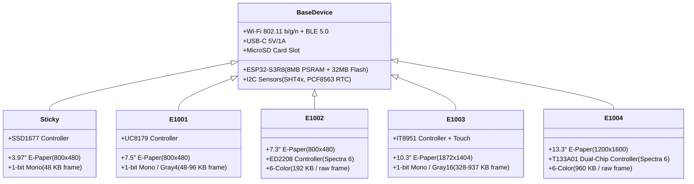

# Architecture & Roadmap: Supporting Seeed Studio reTerminal E-Series (E1001, E1002, E1003, E1004)

## 1. Executive Summary & Goals

This project expands **ScreenTinker MCU** from a single-device target ([reTerminal Sticky](file:///home/rene/github/screentinker_mcu/include/pins_sticky.h)) into a modular, multi-target platform supporting Seeed Studio's entire **reTerminal E Series**:
* **reTerminal Sticky**: 3.97" B/W (800×480, SSD1677)
* **reTerminal E1001**: 7.5" Monochrome / 4-Level Grayscale (800×480, UC8179)
* **reTerminal E1002**: 7.3" 6-Color Spectra 6 (800×480, ED2208 / GDEP073E01)
* **reTerminal E1003**: 10.3" Monochrome / 16-Level Grayscale + Capacitive Touch (1872×1404, IT8951)
* **reTerminal E1004**: 13.3" 6-Color Spectra 6 (1200×1600, T133A01 Dual-Chip)

Both the **embedded ESP32-S3 firmware** and the **cross-platform host simulator (`screentinker_sim`)** will support all 5 models.

---

## 2. Hardware Specification Matrix



### Detailed Specs

| Model | Screen Size | Resolution | Color Depth | E-Paper Controller | Frame Size | Onboard Peripherals |
| :--- | :---: | :---: | :---: | :---: | :---: | :--- |
| **Sticky** | 3.97" | 800 × 480 | 1bpp Mono | SSD1677 | 48,000 B | BQ27220 fuel gauge, BQ25616 charger, 3 buttons, buzzer |
| **E1001** | 7.5" | 800 × 480 | 1bpp / Gray4 | UC8179 | 48,000 B | ADC battery divider, 3 buttons, buzzer, LED (GPIO6), SHT4x, PCF8563 |
| **E1002** | 7.3" | 800 × 480 | 6-Color Spectra 6 | ED2208 | 192,000 B | ADC battery divider, 3 buttons, buzzer, LED (GPIO6), SHT4x, PCF8563 |
| **E1003** | 10.3" | 1872 × 1404 | 1bpp / Gray16 | IT8951 | 328,548 B | Capacitive Touch, ADC battery divider, 3 buttons, buzzer, LED (GPIO16), PCF8563 |
| **E1004** | 13.3" | 1200 × 1600 | 6-Color Spectra 6 | T133A01 (dual CS) | 960,000 B | Front/rear buttons, buzzer, LED (GPIO48), ADC battery divider, PCF8563 |

---

## 3. Firmware Architecture (`platformio.ini` & Pin Headers)

### 3.1 PlatformIO Environment Separation
`default_envs = seeed_reterminal_sticky` is preserved to avoid any regressions. New environments are declared modularly:

```ini
[platformio]
default_envs = seeed_reterminal_sticky

[env:seeed_reterminal_sticky]
platform = espressif32
board = esp32-s3-devkitc1-n8r8
framework = arduino
build_flags =
    -DDEVICE_RETERMINAL_STICKY
    -DBOARD_HAS_PSRAM
...

[env:seeed_reterminal_e1001]
extends = env:seeed_reterminal_sticky
build_flags =
    -DDEVICE_RETERMINAL_E1001
    -DBOARD_HAS_PSRAM

[env:seeed_reterminal_e1002]
extends = env:seeed_reterminal_sticky
build_flags =
    -DDEVICE_RETERMINAL_E1002
    -DBOARD_HAS_PSRAM

[env:seeed_reterminal_e1003]
extends = env:seeed_reterminal_sticky
build_flags =
    -DDEVICE_RETERMINAL_E1003
    -DBOARD_HAS_PSRAM

[env:seeed_reterminal_e1004]
extends = env:seeed_reterminal_sticky
build_flags =
    -DDEVICE_RETERMINAL_E1004
    -DBOARD_HAS_PSRAM
```

### 3.2 Unified Device Profile Abstraction (`device_profile.h`)
Instead of hardcoding SSD1677 pins and dimensions in `src/main.cpp`, a central header `include/device_profile.h` will include the appropriate pin mapping:
* `pins_sticky.h`
* `pins_e1001.h` (SCK=7, MOSI=9, CS=10, DC=11, RST=12, BUSY=13, LED=6, BUZZER=45, BATT_EN=21)
* `pins_e1002.h` (SCK=7, MOSI=9, CS=10, DC=11, RST=12, BUSY=13, LED=6, BUZZER=45, BATT_EN=21)
* `pins_e1003.h` (SCK=7, MISO=8, MOSI=9, CS=10, RST=12, BUSY=13, TFT_EN=11, ITE_EN=21, LED=16, BATT_EN=40)
* `pins_e1004.h` (SCK=7, MISO=8, MOSI=9, CS=10, DC=11, CS1=2, RST=38, BUSY=13, ENABLE=12, LED=48, BATT_EN=21)

---

## 4. Host Simulator Architecture (`screentinker_sim`)

The simulator provides an instant testbench without needing the physical hardware:

1. **CLI & JSON Configuration**:
   * Flag: `--device <sticky|e1001|e1002|e1003|e1004>`
   * Default fallback to `sim_config.json`: `"device_model": "e1001"`
2. **Dynamic Viewport**:
   * Initializes SDL2 window to exact resolution (`800x480`, `1872x1404`, `1200x1600`).
   * Supports `--scale <1-4>` so large panels (like 1872×1404) fit comfortably on standard laptop screens (e.g. at scale 0.5 or scale 1).
3. **Dynamic Pairing Registration**:
   * In `--pair` mode, informs the ScreenTinker server of the exact screen profile:
     ```json
     {
       "screen_profile": "seeed-reterminal-e1001",
       "screen_width": 800,
       "screen_height": 480
     }
     ```
4. **Adaptive UI Generator**:
   * `setup_screen.cpp` adapts QR code and pairing code centering dynamically based on `EPD_WIDTH` and `EPD_HEIGHT`.

---

## 5. Phased Implementation Roadmap

* **Phase 1: Simulator Multi-Device Profile Engine**
  * Update `sim_config.h` & `sim_config.cpp` to parse `--device` and profile presets.
  * Update `sim_display.h` & `sim_display.cpp` to dynamically allocate and resize viewport.
  * Update `main_sim.cpp` pairing flow to announce chosen model.
* **Phase 2: Responsive Setup Screen**
  * Refactor `setup_screen.cpp` so splash screens, pairing PINs, and QR codes scale and center properly for 800×480, 1872×1404, and 1200×1600.
* **Phase 3: Firmware Pinout & Profile Headers**
  * Create `include/pins_e1001.h`, `include/pins_e1002.h`, `include/pins_e1003.h`, `include/pins_e1004.h`.
  * Create `include/device_profile.h` and conditionalize `config.h` dimensions.
  * Add corresponding environments in `platformio.ini`.
* **Phase 4: Verification & Server Integration**
  * Test simulated pairing with local ScreenTinker server (`192.168.100.222:3001`) across all 5 profiles.
  * Validate bitmap downloads and BMP snapshot outputs.
